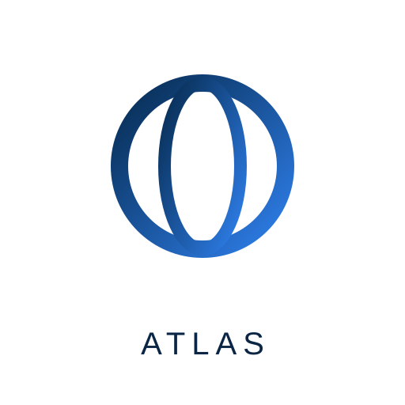

# Atlas



**Atlas — Alpha 3.1 (1.0.3-alpha.1)** · MIT · free and open source. (Repo name is still
`live-browser-skill` for now — a technical name, kept until publishing.)

A free, open-source **MCP server + Agent Skill** that gives an AI builder
(Lovable, Replit Agent, Claude Code, Cursor) a **real browser it can drive** —
with its own dedicated Google login, a **live view** of everything it does,
and **no payment ability ever**.

## What it is

- A real Chromium browser (Playwright, persistent profile) the agent drives
  through MCP tools: navigate, snapshot, click, type, screenshot, tabs,
  viewport emulation, text extraction.
- **Its own Google login:** you sign in once, manually, with a **dedicated
  Google account**. The session persists in the browser profile.
- **Live View:** real live video of the browser (`/video.mjpeg`) + every
  action at `http://localhost:3100/` — you watch everything live, picture
  only, no audio. A human check pauses the browser and shows a banner; Atlas
  never solves it.
- **REST API** next to MCP on the same port (`POST /api/navigate`,
  `POST /api/screenshot`, `GET /api/status`) for in-app AI use.
- **Session recording:** actions + errors + screenshots saved to
  `live/session-<timestamp>.json`.

## What it is NOT

- **Not a paid feature. It never pays.** Checkout/payment URLs, pay buttons,
  and card-like numbers are blocked in code (`server/guard.js`). If a tool
  says "Payment blocked", that is the skill working as intended.
- **Not password storage.** The AI never sees, types, or stores any password.
- **Not a runtime feature for end users.** In Lovable / Replit, the browser
  is a build-time tool for the agent. The published app does **not** inherit
  the browser or the Google session. Lovable and Replit accept custom MCP
  servers only as remote HTTPS connectors while building, and they cannot
  reach `localhost` — deploy the server first (see `deploy/`).

## Quickstart

```bash
npm install
npx playwright install chromium
npm start            # stdio MCP server (Claude Code / Cursor)
npm run start:http   # HTTP server + Live View on http://localhost:3100

# Or, after `npm link` (once, in the repo):
#   atlas --http         # the `atlas` command, anywhere
# Every connection method: see `docs/INSTALL.md`.
```

Config: see `.env.example`. Key variables:

| Variable | Default | Meaning |
|---|---|---|
| `LIVE_BROWSER_PORT` | `3100` | HTTP port (Live View + `/mcp` + REST) |
| `LIVE_BROWSER_PROFILE` | `./.live-browser-profile` | Persistent browser profile |
| `LIVE_BROWSER_HEADED` | `0` | `1` = visible window (needed for manual sign-in) |
| `LIVE_BROWSER_READONLY` | `0` | `1` = block click/type |
| `LIVE_BROWSER_ALLOW_SENSITIVE` | `0` | `1` = allow delete/send/publish |
| `LIVE_BROWSER_MAX_STEPS` | `100` | Max mutating actions per run |
| `LIVE_BROWSER_ALLOWED_DOMAINS` | _(empty)_ | Comma-separated allow list |
| `LIVE_BROWSER_BLOCKED_DOMAINS` | _(empty)_ | Comma-separated block list |
| `ARTEMIS_MCP_URL` | _(empty)_ | URL of your own Artemis MCP server for `phone_status`; unset = no phone |

## Wave 3 (1.0.1-alpha) + Alpha 2 (1.0.2-alpha): phone, 50+ model router, verified Live View, Hikma Lab

**Alpha 2 adds:**
- **50+ model router** — 50 free models (OpenRouter `:free`, Groq free, Gemini free tier, SambaNova free, local Ollama) in chat/code/vision/audio/phone routes, ranked by task strength, not fame. `node scripts/route-model.js --task code` picks the next model, skipping exhausted ones. See `docs/MODEL-ROUTER.md`.
- **Verified Live View** — the live feature was re-checked end to end on 2026-11-13 (see `docs/LIVE-VERIFIED.md`): pages, status, events, dashboard and the payment guard all work live; what still needs your own machine is real-site navigation (this build VM has no direct egress).

## Alpha 3 (1.0.3-alpha): real live video, public host, human-check handling

**Alpha 3 adds:**
- **Real live video** — the Live View now streams the browser as a real moving picture (`/video.mjpeg`, MJPEG from the renderer's CDP screencast), with a still-screenshot fallback if the stream is unavailable. Picture only, no audio: a browser screencast has no audio channel. The screencast runs only while someone is watching.
- **Public host, not localhost** — on a hosted deploy the server reports its real public URL (`RAILWAY_PUBLIC_DOMAIN`, or `ATLAS_PUBLIC_URL`) in `/status`, tool messages, and the Live View, so links work from a phone. Local runs still use `http://localhost:3100/`.
- **Human-check handling (no bypass)** — when a page shows a human check (Cloudflare "Just a moment...", `__cf_chl_` URL), Atlas pauses, shows a banner in the Live View, and logs it. It never solves, clicks through, or bypasses the check, and it contains no CAPTCHA solver or stealth-bypass library — see `SECURITY.md` ("Human checks").
- **Hikma Lab setup** — `docs/HIKMA-LAB.md`: the user's Hikma Lab app and Zakat al-Hikma AI on Atlas, with the dedicated Google account kept local only (`ATLAS_GOOGLE_ACCOUNT`).

## Alpha 3.1 (1.0.3-alpha.1): rebuilt Live View, bypass research, slow-load fix

**Alpha 3.1 adds:**
- **Live View rebuilt from scratch** — the page is now organized and Arabic-first: status cards (browser / current page / steps with progress bar / mode / video), a prominent "last step" line in plain Arabic, a clean action log (newest first, Arabic labels), an errors panel, and a short "how to use this page" guide. The video stays the same real MJPEG stream (picture only, no audio).
- **You can drive the browser from Live View** — a "go to a link" box (`POST /api/navigate`) plus a Screenshot button (`POST /api/screenshot`), alongside Pause / Resume / Record. A connection indicator and "last updated" time show the page is alive.
- **Bypass research, documented, not added** — `docs/HUMAN-CHECKS.md` records what was found (2Captcha / Anti-Captcha / CapSolver, stealth plugins, stealth browsers, residential proxies) and why none of it is in Atlas: modern challenges are verdicts, not puzzles; stealth breaks on every detection update; and the hosted server's datacenter IP is the worst signal for Cloudflare. The detection + banner + auto-pause from Alpha 3 stays.
- **Slow first load fixed** — page navigation timeout raised from 30s to 60s (Railway containers are slow on first load).

- **Real Android phone (Artemis):** [`docs/ARTEMIS.md`](docs/ARTEMIS.md) —
  Google's `google/artemis` (Apache 2.0) drives a real Android phone or
  emulator over MCP. This repo only checks its status (`phone_status`);
  Artemis runs separately with its own Python 3.12+ install, a dedicated
  test device, and your own paid model key. Android only, no iOS yet,
  no voice yet.
- **Model router:** [`docs/MODEL-ROUTER.md`](docs/MODEL-ROUTER.md) +
  `config/model-router.example.json` — switch models automatically by task
  (code / chat / vision) across Ollama local, OpenRouter `:free`, and the
  Gemini free tier, with a fallback chain and queue + pause at the limit.
- **Multi-agent:** [`docs/MULTI-AGENT.md`](docs/MULTI-AGENT.md) +
  `config/agents.example.json` — one agent = one browser profile + one
  Google account + one device. The AI **cannot** create Gmail accounts
  itself (Google requires human phone verification); you create each one
  manually.
- **Plugins:** [`docs/PLUGINS.md`](docs/PLUGINS.md) +
  `plugins/registry.example.json` — install a GitHub tool on demand, only
  after a license check, pinned to a commit SHA. Never everything at once.
- **Modes library:** [`config/modes/`](config/modes/) — coding, content,
  research, testing, chat, plus coding-python, coding-web, coding-api,
  coding-scripts, content-writing. Each mode sets its preferred model
  route, its allowed tools, and its step budget. Switch with the
  `browser_mode` tool. A mode can only narrow what the agent may do,
  never widen past a guard.
- **Code tools registry:** [`docs/CODE-TOOLS.md`](docs/CODE-TOOLS.md) +
  `config/code-tools/` — one JSON file per language (python, javascript,
  typescript, go, rust, java, csharp, php, sql, html-css, bash) with
  runtime, run/test commands, formatter and linter. List them with
  `npm run list-tools`. A new language is one JSON file — Atlas does not
  claim to "contain every language in the world".
- **Platforms:** [`docs/PLATFORMS.md`](docs/PLATFORMS.md) — Android
  (Artemis), Windows (Microsoft UFO), iPhone (iphone-control, harder
  than Android — iOS is closed). Status tools: `phone_status`,
  `windows_status`, `iphone_status`.
- **Famous tools (official integrations only):**
  [`docs/FAMOUS-TOOLS.md`](docs/FAMOUS-TOOLS.md) — UFO, Artemis, GitHub
  MCP, Playwright, Ollama, OpenRouter. Closed/paid tools are never
  copied or auto-merged; integration is only via their official MCP/API
  with your account and key, after your approval.
- **Live test:** [`docs/LIVE-TEST.md`](docs/LIVE-TEST.md) — test Atlas
  like a real person: headed browser, persistent profile, real site,
  Live View. No CAPTCHA bypass is tested or built.
- **Dashboard (PWA):** open `/dashboard` on the running server —
  Material 3 Expressive control panel with live screenshot, agents,
  model router, devices, and Pause / Resume / Approve / Record
  buttons. Design tokens: [`docs/DESIGN.md`](docs/DESIGN.md).
- **Every connection:** [`docs/CONNECTIONS.md`](docs/CONNECTIONS.md) —
  MCP stdio, MCP Streamable HTTP, REST, Agent Skill, CLI, SSE, Dashboard.
- **Pooled free models:** [`docs/FREE-MODELS.md`](docs/FREE-MODELS.md) —
  OpenRouter `:free`, Gemini free tier, Groq free tier, and local Ollama,
  pooled by the router. Large pooled free credit — never limitless.
- **Dependency updates:** [`docs/UPDATES.md`](docs/UPDATES.md) +
  `npm run update-deps` — update, run `npm test` as the gate, roll back
  on failure. No blind update to latest.
- **Name candidates:** [`NAME.md`](NAME.md) — **Atlas, decided**,
  Alpha 2 (1.0.2-alpha). (Earlier candidates: Baseer, Nafitha, Ayn.)
- **Pause / Resume / Record** in the Live View, and `browser_sitemap`.

## Honest limits — read before you rely on this

- **Lovable / Replit:** custom MCP servers work only as remote HTTPS chat
  connectors *while building*; the published app does not inherit the
  browser or the Google session, and they cannot reach `localhost`.
- **Credits:** this tool is free, but the models are not unlimited.
  OpenRouter `:free` models are **20 requests/minute, 50/day, 1,000/day
  after $10 lifetime purchases**. Lovable's own credits are Lovable's, and
  Artemis's model key is paid by you to your provider. Nothing here makes
  any of that unlimited or 24-hour non-stop. Local Ollama is the only
  no-meter option, limited by your own hardware.
- **No CAPTCHA bypass, no automatic Gmail creation, no merging all
  trending repos into this repo.** These are under **Never** in
  [`FEATURES.md`](FEATURES.md), with the reasons.
- **Live View has no auth in 1.0.3-alpha.1.** Run it on `localhost`, or put a
  deployed instance behind HTTPS + access controls. See `SECURITY.md`.
- **Local VM check (2026-11-13):** Chromium in the build VM could not reach
  the public internet directly (`ERR_TUNNEL_CONNECTION_FAILED`), so
  real-site navigation still needs verifying on a machine / deploy with
  direct egress. The tests, MCP tools, REST API, and Live View HTTP checks
  all pass locally; a live navigation check on your own machine is the
  remaining verification step.

## Google sign-in (manual, once, by you)

1. Start with a visible window: `LIVE_BROWSER_HEADED=1 npm run start:http`
2. Ask the agent to run `browser_google_signin` (opens accounts.google.com).
3. **Sign in yourself in the browser window** with a dedicated Google account
   created for the AI browser — never your main personal account.
4. Never paste the password in chat. Never give it to the AI.
5. The session is saved in the profile and reused next time.

## Tools

| Tool | What it does |
|---|---|
| `browser_start` | Start (or reuse) the browser |
| `browser_navigate` | Go to a URL (payment/blocked URLs refused) |
| `browser_snapshot` | Accessibility tree + clickable `[ref=N]` elements |
| `browser_click` | Click by ref or selector (read-only/sensitive/payment guarded) |
| `browser_type` | Type into a field (card numbers refused) |
| `browser_press` | Press a key (Enter, Tab, Escape…) |
| `browser_screenshot` | Viewport screenshot (updates Live View) |
| `browser_full_screenshot` | Full-page screenshot |
| `browser_extract_text` | Visible page text + word count |
| `browser_tabs` | List / new / switch / close tabs |
| `browser_set_viewport` | Presets: desktop / mobile / tablet, or custom size |
| `browser_status` | URL, title, tabs, Google state, errors, steps, session file |
| `browser_sitemap` | Link tree of the page: headings + every link (up to 200) |
| `browser_pause` | Pause the agent so you can take over the browser yourself |
| `browser_resume` | Resume the agent after a pause |
| `browser_mode` | View or switch the current mode (coding / content / research / testing / chat) |
| `phone_status` | Is a Google Artemis Android phone attached? (`not-configured` unless `ARTEMIS_MCP_URL` is set) |
| `browser_google_signin` | Open Google sign-in for manual login |
| `browser_stop` | Close the browser (profile + session recording kept) |

## REST API (same port, same payment guard)

```bash
curl http://localhost:3100/api/status
curl -X POST http://localhost:3100/api/navigate \
  -H 'Content-Type: application/json' -d '{"url":"https://example.com"}'
curl -X POST http://localhost:3100/api/screenshot --output shot.png
```

`POST /api/navigate` to a checkout URL returns `403` with the payment-blocked
message. Step limit returns `429`.

## Setup guides

- Claude Code: [`docs/CLAUDE-CODE.md`](docs/CLAUDE-CODE.md)
- Cursor: [`docs/CURSOR.md`](docs/CURSOR.md)
- Lovable: [`docs/LOVABLE.md`](docs/LOVABLE.md) (remote MCP only — deploy first)
- Replit: [`docs/REPLIT.md`](docs/REPLIT.md) (remote MCP only — deploy first)
- Deploy: [`deploy/railway.md`](deploy/railway.md), [`deploy/render.md`](deploy/render.md)
- Phone (Artemis): [`docs/ARTEMIS.md`](docs/ARTEMIS.md)
- Platforms (Android / Windows / iPhone): [`docs/PLATFORMS.md`](docs/PLATFORMS.md)
- Live test: [`docs/LIVE-TEST.md`](docs/LIVE-TEST.md)
- Dashboard design: [`docs/DESIGN.md`](docs/DESIGN.md)
- Connections: [`docs/CONNECTIONS.md`](docs/CONNECTIONS.md)
- Model router: [`docs/MODEL-ROUTER.md`](docs/MODEL-ROUTER.md)
- Free models (pooled): [`docs/FREE-MODELS.md`](docs/FREE-MODELS.md)
- Code tools: [`docs/CODE-TOOLS.md`](docs/CODE-TOOLS.md)
- Famous tools: [`docs/FAMOUS-TOOLS.md`](docs/FAMOUS-TOOLS.md)
- Multi-agent: [`docs/MULTI-AGENT.md`](docs/MULTI-AGENT.md)
- Plugins: [`docs/PLUGINS.md`](docs/PLUGINS.md)
- Updates: [`docs/UPDATES.md`](docs/UPDATES.md)
- Modes: [`config/modes/`](config/modes/) (coding, content, research, testing, chat)
- Name: [`NAME.md`](NAME.md) — Atlas, decided
- Roadmap: [`FEATURES.md`](FEATURES.md)

## Safety

- Payment guard in `server/guard.js`, unit-tested (`test/payment-guard.test.js`).
- **HTTPS-only** navigation (except localhost), TLS verification never
  disabled. See [`SECURITY.md`](SECURITY.md).
- Read-only mode, domain allow/block lists, sensitive-action block, step limit.
- Pause / Resume in the Live View, and recording that starts/stops only on
  your command, stored locally.
- No credentials, tokens, or passwords anywhere in the repo. See
  [`SECURITY.md`](SECURITY.md).

## License

MIT — see [`LICENSE`](LICENSE).

---

## بالعربي (ملخّص)

**الفكرة:** أداة مجانية ومفتوحة المصدر بتدي الذكاء الاصطناعي (Lovable، Replit،
Claude Code، Cursor) متصفح حقيقي يقدر يفتحه ويستخدمه: يفتح مواقع، يدوس على
أزرار، يملا نماذج، ويسجّل دخول بجوجل — وانت بتشوف كل حاجة بيعملها **لايف**
من صفحة `http://localhost:3100/`.

**الخطوات:**

1. `npm install` ثم `npx playwright install chromium` ثم `npm run start:http`
2. تسجيل الدخول بجوجل بيتم **يدويًا مرة واحدة منك انت**، وبحساب جوجل مخصّص
   للذكاء الاصطناعي — مش حسابك الشخصي — وممنوع تبعت كلمة السر في الشات.
3. في Lovable وReplit لازم تنشر السيرفر الأول على رابط `https://` (شوف
   `deploy/`) لأنهم مش بيوصلوا لـ `localhost`، والتطبيق المنشور **مش** بياخد
   المتصفح — المتصفح أداة وقت البناء بس.

**الأمان:** الأداة **مش بتدفع أبدًا** — صفحات الدفع محظورة وأرقام البطاقات مش
بتتكتب. وفيه وضع قراءة فقط، وقوائم سماح/حظر للدومينات، وحماية من الحذف
والنشر، وحد أقصى للخطوات، وتسجيل كامل للجلسة. التصفح `https` بس (ما عدا
`localhost`)، والتحقق من شهادات TLS مش بيتقفل أبدًا.

**الموبايل (Artemis):** الأداة ممكن تتوصل بموبايل أندرويد حقيقي عن طريق مشروع
جوجل Artemis (شوف `docs/ARTEMIS.md`) — بس بجهاز اختبار مخصّص، مش موبايلك
الشخصي، وبمفتاح نموذج مدفوع منك. أندرويد بس، ومفيش iOS ولا صوت لسه.

**حدود بصراحة:** مفيش نماذج مجانية بلا حدود — OpenRouter المجاني **20 طلب في
الدقيقة، 50 في اليوم، 1000 في اليوم بعد مشتريات بـ 10 دولار**. لكن لما تتجمع
مع Gemini وGroq المجاني وOllama المحلي، الرصيد المجاني المجمّع بيبقى كبير —
ومع ذلك كل مزود ليه حدّ أقصى، شوف `docs/FREE-MODELS.md`. والذكاء
الاصطناعي **مش بيعمل حساب Gmail لوحده** (جوجل بتطلب تحقق بشري برقم موبايل)،
**ومش بيتخطّى CAPTCHA** (انت بتحلّها بنفسك لما تظهر، والأداة مفيهاش أي حلّال
Captcha). كل ده مكتوب في `FEATURES.md` تحت "Never". واسم الأداة بقى **Atlas**،
إصدار Alpha 2 (1.0.2-alpha) — شوف `NAME.md`.

**إيقاف مؤقت وتسجيل:** من صفحة الـ Live View تقدر توقف الذكاء الاصطناعي
(Pause) وتاخد المتصفح بنفسك، وترجّعه (Resume)، وتشغّل/توقف التسجيل — والتسجيل
بيتخزن على جهازك بس، ومش بيشتغل غير بأمرك انت.
